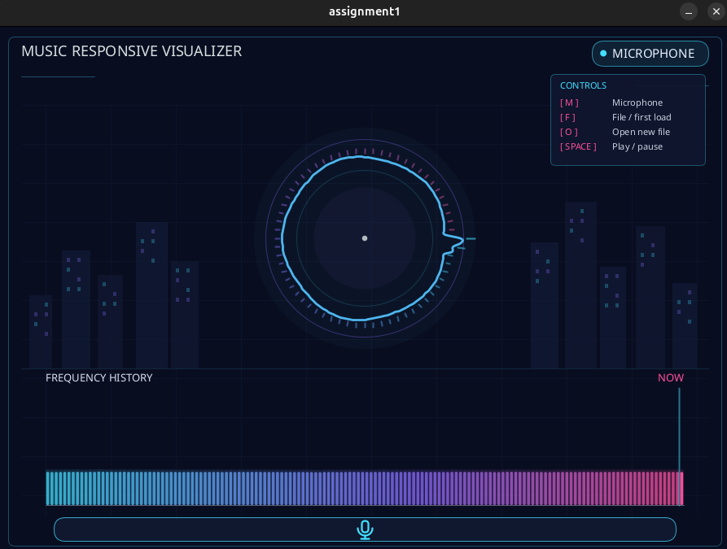
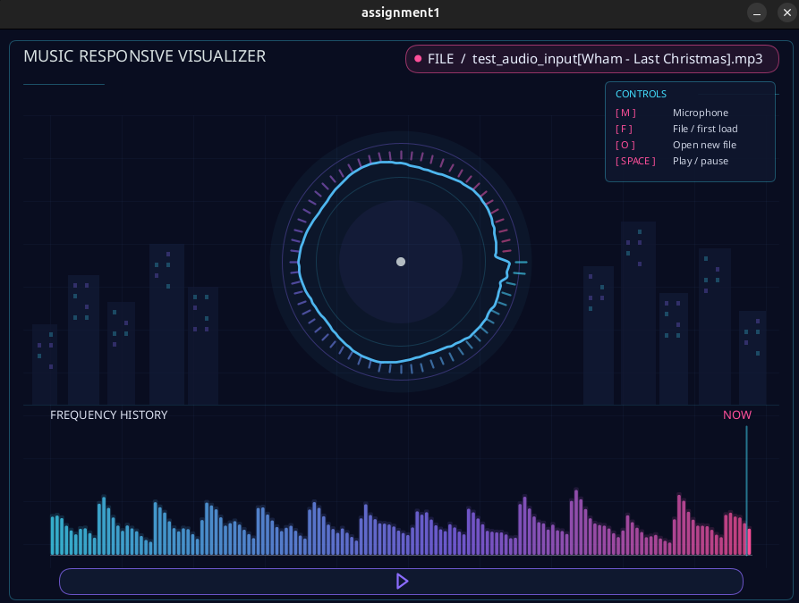
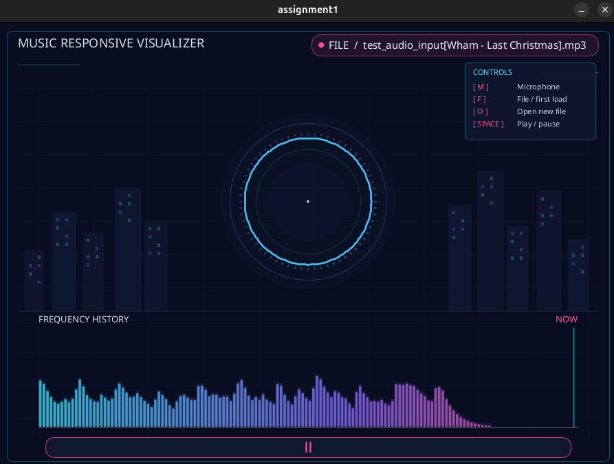

# Music-Responsive Visualizer Project
This project was built using Processing in Java mode.   
It allows the user to input a MP3, WAV, or AIFF file and see 64 different frequency values. It also includes a microphone input mode.
## Features
- Use amplitude (loudness) → circle size, and bar height for the frequency history.
- Use frequency spectrum → radial distortion and bars.
- Microphone mode and file upload mode.
- History trail to show sound change over time.
## How to Run
1. Open `assignment1.pde` in the Processing IDE.
2. Click the **Run** button ( ).
3. Check the controls out, but the application launches in microphone mode.
## Controls
- `M`: Microphone mode
- `F`: File mode / initial file upload
- `O`: Open new file, generally for changing songs
- `Space`: Pause / play song loaded
## Example Output
### In Microphone Mode:   
   
### In File Mode Playing (using the included audio test file):   

### In File Mode Pausing (using the included audio test file):   

## Future Considerations
- Background noise suppression should be looked at because microphone keeps picking up white noise, making it harder to test the frequency values.   
- For visual appeal, look into how to make lights on the buildings gradually glow randomly without disturbing the main focal point.